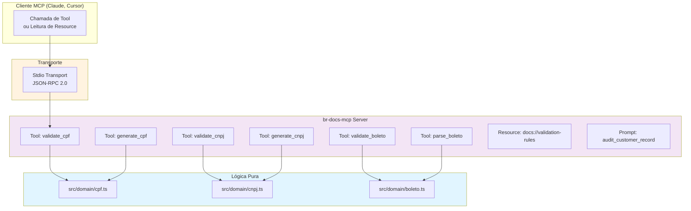

# br-docs-mcp

Servidor MCP (Model Context Protocol) para validação e geração de documentos brasileiros: CPF, CNPJ e boleto bancário.

## O que é

Uma implementação de servidor MCP que expõe 6 ferramentas para validar e gerar documentos brasileiros. Implementa os algoritmos de validação (módulo 11 para CPF e CNPJ, módulo 10 e 11 para boleto) e permite que clientes MCP (Claude, Cursor, etc.) utilizem essas funcionalidades via chamadas de ferramentas.

## Funcionalidades e Tecnologias

| Funcionalidade | Descrição | Tecnologia |
|---|---|---|
| **Validação de CPF** | Valida CPF com algoritmo mod11, aceita formatado e bruto | TypeScript |
| **Geração de CPF** | Gera CPF válido e aleatório | Pure logic |
| **Validação de CNPJ** | Valida CNPJ com pesos mod11 específicos | TypeScript |
| **Geração de CNPJ** | Gera CNPJ válido e aleatório | Pure logic |
| **Validação de Boleto** | Valida linha digitável (47 dígitos, layout FEBRABAN): mod10 nos 3 campos + DV geral mod11 na posição 33 | TypeScript |
| **Parse de Boleto** | Extrai banco, valor e vencimento via fator de vencimento (com rollover de 22/02/2025) | Pure logic |
| **MCP Tools** | Expõe 6 ferramentas via Model Context Protocol | @modelcontextprotocol/sdk |
| **MCP Resource** | `docs://validation-rules` com a documentação dos algoritmos | Markdown |
| **MCP Prompt** | `audit_customer_record` para auditar cadastros usando as tools | Template |
| **Testes** | 40 testes, incluindo E2E MCP real (Client ↔ Server via InMemoryTransport) | Vitest |
| **Clean Architecture** | Lógica pura separada da camada MCP | src/domain |

## Arquitetura



## Como rodar

### Pré-requisitos
- Node.js >= 22.12

### Instalação
```bash
npm install
```

### Desenvolvimento
```bash
npm run dev
```

### Build
```bash
npm run build
```

Saída em `dist/index.js` com shebang, pronto para uso via `npx br-docs-mcp`.

## Como testar

### Rodar testes
```bash
npm test
```

### Modo watch
```bash
npm run test:watch
```

### Type check
```bash
npm run type-check
```

Todos os 40 testes rodam 100% offline e cobrem:
- Validação de CPF/CNPJ formatado e bruto
- Rejeição de dígito verificador errado, comprimento inválido, dígitos repetidos
- Roundtrip gerar → validar (20 iterações para CPF e CNPJ)
- Boleto: linha válida construída nos testes (com mod10/mod11 independentes), campos corrompidos, DV geral errado
- Parse de boleto: banco, valor e vencimento — incluindo o rollover do fator (1000 = 22/02/2025) e fator 0000 (sem vencimento)
- E2E MCP real: `Client` e `McpServer` conectados por `InMemoryTransport.createLinkedPair()`, listando as 6 tools, chamando `validate_cpf`, lendo o resource e obtendo o prompt

## Uso com clientes MCP

### Configuração no Claude Desktop / Cursor

Adicione a entrada no `mcp.json`:

```json
{
  "mcpServers": {
    "br-docs-mcp": {
      "command": "npx",
      "args": ["br-docs-mcp"]
    }
  }
}
```

### Exemplo de chamada
```json
{
  "name": "validate_cpf",
  "arguments": {
    "cpf": "529.982.247-25"
  }
}
```

Resposta:
```json
{
  "valid": true
}
```

### Ferramentas disponíveis
- `validate_cpf` - Valida CPF → `{ "valid": true }` ou `{ "valid": false, "reason": "check digit mismatch" }`
- `generate_cpf` - Gera CPF válido → `{ "cpf": "..." }`
- `validate_cnpj` - Valida CNPJ
- `generate_cnpj` - Gera CNPJ válido
- `validate_boleto` - Valida linha digitável de boleto
- `parse_boleto` - Extrai dados do boleto → `{ "bankCode": "001", "amount": 1500, "dueDate": "2025-02-22" }`

### Resource disponível
- `docs://validation-rules` - Documentação dos algoritmos

### Prompt disponível
- `audit_customer_record` - Audita registros de clientes usando as tools

## Estrutura do projeto

```
.
├── src/
│   ├── domain/
│   │   ├── cpf.ts          # Lógica pura de CPF
│   │   ├── cnpj.ts         # Lógica pura de CNPJ
│   │   └── boleto.ts       # Lógica pura de boleto (layout FEBRABAN)
│   ├── server.ts           # Servidor MCP (tools, resource, prompt)
│   ├── validation-rules.ts # Markdown servido pelo resource
│   └── index.ts            # Entrypoint stdio (#!/usr/bin/env node)
├── tests/
│   ├── domain/
│   │   ├── cpf.test.ts
│   │   ├── cnpj.test.ts
│   │   └── boleto.test.ts
│   └── e2e/
│       └── server.test.ts
├── package.json            # bin: br-docs-mcp → dist/index.js
├── tsconfig.json
├── vitest.config.ts
├── README.md               # Este arquivo
├── LICENSE                 # MIT
└── .gitignore
```

## Publicação no npm

### Build e teste
```bash
npm run type-check
npm test
npm run build
```

### Publicar
```bash
npm publish
```

O script `prepublishOnly` garante que testes e build passam antes de publicar.

## Origem

Inspirado em conceitos do curso de pós-graduação em **Engenharia de Software com IA Aplicada** — implementação própria do zero, usando TypeScript e clean architecture para demonstrar:
- Design domain-driven
- Separação de responsabilidades (domain vs. transport)
- Algoritmos de validação (mod11, mod10)
- Model Context Protocol (MCP)
- Test-driven development com Vitest
- Empacotamento npm com tipos

## Licença

MIT - Copyright (c) 2026 Vicente Moura
